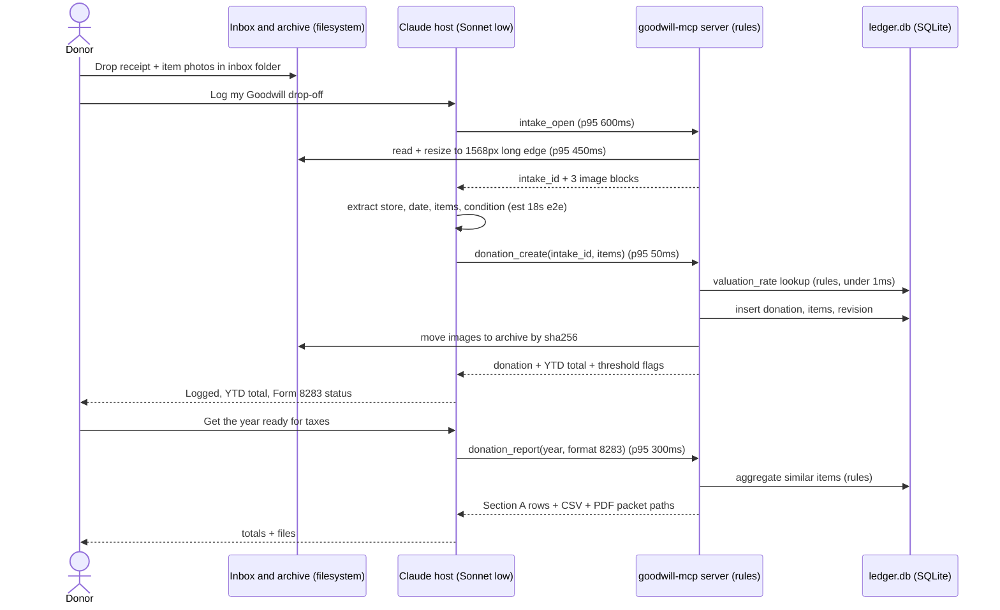
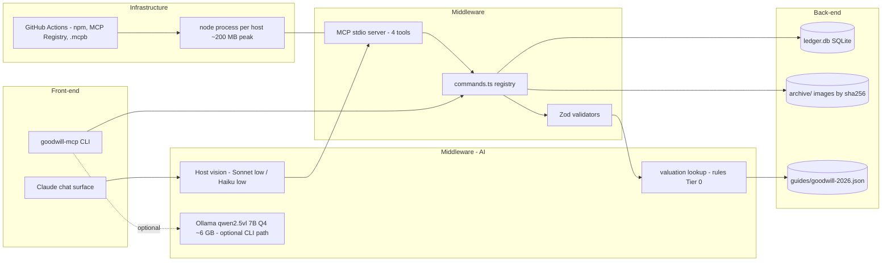
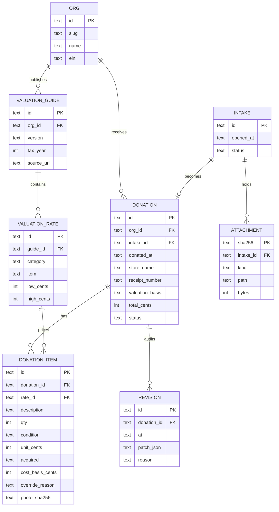
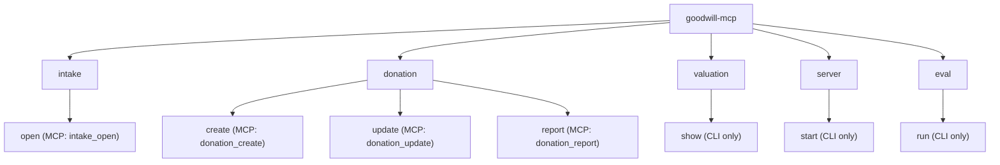

# Architecture

The same node names appear in every diagram, the command registry and the code. Each hop on the user path shows its p95 budget.

## Features and what they use

| Feature | Components | Tables owned | Models called |
|---|---|---|---|
| Log a donation | `intake_open`, `donation_create`, registry, validators, valuation rules | `intake`, `attachment`, `donation`, `donation_item` | Host model for photo extraction (Sonnet low / Haiku low) |
| Correct a donation | `donation_update` | `revision` | None |
| Year-end export | `donation_report` | none (reads) | None |
| Price guide | guide loader | `org`, `valuation_guide`, `valuation_rate` | None |

## Layers: state and processes

| Layer | State (how it exists) | Process: input → processing → output |
|---|---|---|
| Front-end | Chat surface in the host; `goodwill-mcp` CLI | Request or command → registry lookup → table or JSON |
| Middleware | `commands.ts` registry; MCP stdio server; Zod validators | Tool call → validate → run command → structured result |
| Middleware — AI | Host model; `log_donation` prompt; valuation rules | Photos → host extracts `DonationDraft` → rules price and flag it |
| Back-end | `ledger.db` (SQLite); `archive/` images; `guides/*.json` | Draft → insert rows + revision → donation record |
| Infrastructure | One Node process per host session; GitHub Actions | Release tag → test → npm + `.mcpb` + registry entry |

## Sequence: log a donation, then year-end export



## Architecture: five layers



## ERD: the full back-end

Every table has a foreign key. A new charity is one `org` row plus one `valuation_guide`.



## Command tree (CLI = MCP, one registry)



## Directory

```text
goodwill-mcp/
  src/commands.ts        one registry: MCP tools, CLI commands, docs table
  src/server.ts          MCP stdio server
  src/cli.ts             CLI entry
  src/rules/             valuation lookup, thresholds, Form 8283 grouping
  src/db/                migrations and queries
  guides/                versioned price-guide JSON per organization
  fixtures/              synthetic receipts and photos
  docs/PROPOSAL.md
  ARCHITECTURE.md
```

## Pattern table

| Pattern | Used for | Rule |
|---|---|---|
| Registry entry | Every tool and command | One entry yields the MCP tool, CLI command and docs row |
| Rule function | Valuation, thresholds, grouping | Pure function, no model call |
| Append-only revision | Every change to a donation | Never edit history in place |
| Versioned JSON guide | Each organization's price list | New charity is a new file, not new code |
